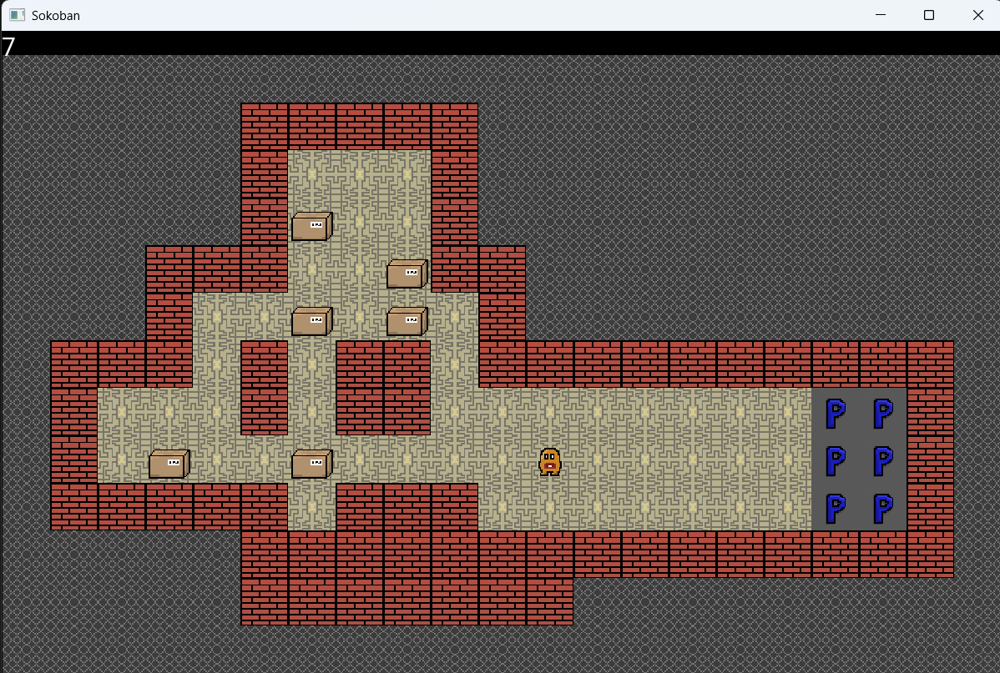

# Sokoban

## Overview
The programme is a recreation of the classic Japanese game Sokoban with custom-made textures. It allows the user to create their own maps.



## Features
1. Game window is resizable
2. Parked boxes are marked as done
3. Counter keeps track of your time

## Setup
Before downloading make sure you have cmake installed. To run the programme, run commands:

```
git clone https://github.com/zagalahubert/Sokoban.git
cd Sokoban
cmake -B build -A x64
cmake --build build --config Release
cd build/Release
.\SokobanGame.exe    
```

## Technologies
Technologies used:
1. SFML
2. C++
3. CMake
4. Roboto font (Apache 2.0)

## Creating your own maps
To create a map, simply write a .txt file using format:

- \* - void - use it as a padding to form a level
- X - wall
- &lt;space&gt; - floor
- B - box
- S - starting point
- P - parking spots

***Note:*** while creating a map the game **does not** provide **any validator**. For now there is also no way to choose a level at runtime. To change a map, edit `mapFileName` variable in `Application.cpp`.

## Coming...
1. Incorporating ImGui to allow the user to load in their own map easier.
2. Adding level validator